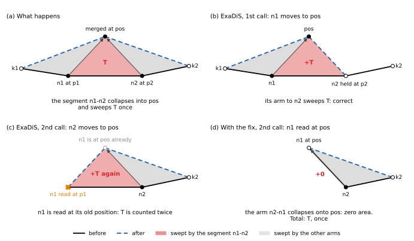
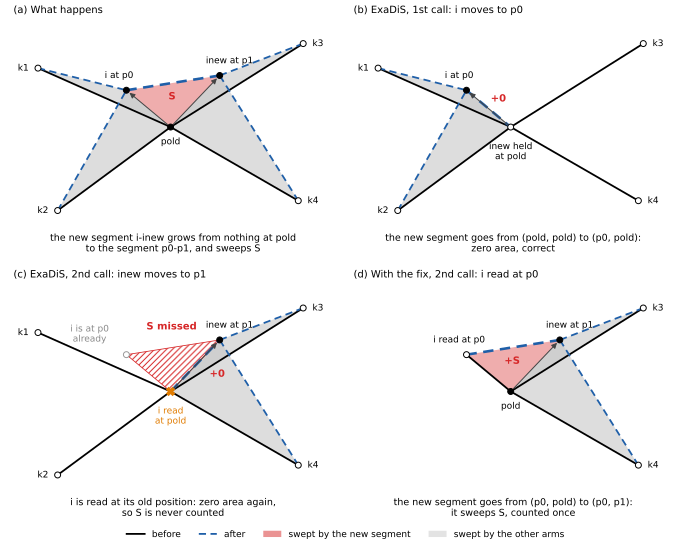

# Bug report: ExaDiS miscounts the plastic strain of one segment in a merge and in a split

- **Code:** ExaDiS at commit `99b17ca`.
- **Date:** 2026-10-24.

## Summary

Two topological operations move two nodes at once: `SerialDisNet::merge_nodes_position` and `execute_split`. Each accounts its plastic strain as two single-node moves, two calls to `update_node_plastic_strain`. But the second move is evaluated with the first node still at its old position. For the segments that join a moving node to nodes the operation does not move, this does no harm: those nodes are read where they really are. For the segment that joins the two moving nodes, it gives the wrong area:

- **a merge counts the joining segment's swept area twice;**
- **a split does not count the segment it creates at all.**

In ExaDiS as it stands, the effect on results is small or nil:

- **The split defect never changes a number.** Both topology handlers place the two products of a split on one line through the old position, so the segment the split creates sweeps no area.
- **The merge defect changes the plastic strain only rarely, and only a little.** It needs two nodes joined by a segment to merge at a point off that segment's line. In ExaDiS that happens only in collisions, between nodes closer together than about the collision distance `rann`, so each event miscounts at most a triangle of about that size.

In realistic runs, binary junctions forming and unzipping, ExaDiS' plastic strain matched the area swept to round-off in every phase of every step. These are therefore defects of the accounting in general, which would show if a caller placed the nodes differently; configurations built for the purpose show both on ExaDiS itself, the merge through its collision and the split through its replay of a recorded split (see "Tests"). The fix costs a few lines in each function ("Proposed fix"). `System::plastic_strain`, the plastic strain of time integration, is not affected: it agrees with an independent implementation to round-off.

## How ExaDiS accounts a topological move

`update_node_plastic_strain(i, pold, pnew, dEp)` (`src/network.cpp`, line 68) accounts for node `i` moving from `pold` to `pnew` while every neighbour `k` stays at its current position `p_k`. Each arm then sweeps the triangle (`pold`, `p_k`, `pnew`), with area vector

    n = 0.5 (p_k - pold) x (pnew - p_k),    P = outer(n, b) / V,    dEp += 0.5 (P + P^T),

where `b` is the arm's Burgers vector directed from `i` to `k`. The function does not move node `i`. It only reads positions, those of `i`'s neighbours included, and adds to `dEp`; moving the node is left to the caller. `move_node` (`src/network.cpp`, lines 49 to 52), for instance, calls it and then sets `nodes[i].pos = cell.pbc_fold(pos)`. For one node, this is exact. For several nodes moved one after another, it is exact as well, provided each move is evaluated against the positions the earlier moves left. The sum then telescopes to the change in the network's swept-area functional, the sum over segments of `outer(0.5 r1 x r2, b) / V`. Both defects break that proviso.

## 1. A merge counts the joining segment twice

```cpp
// src/network.cpp, SerialDisNet::merge_nodes_position
update_node_plastic_strain(n1, nodes[n1].pos, pos, dEp_updt);   // line 210
update_node_plastic_strain(n2, nodes[n2].pos, pos, dEp_updt);   // line 211
...
nodes[n1].pos = cell.pbc_fold(pos);                             // line 251
```

Say `n1` at `p1` and `n2` at `p2` are joined by a segment and merge at `pos`. That segment collapses into the point `pos`, sweeping the triangle T = (`p1`, `p2`, `pos`) once (figure 1a). The first call accounts for `n1` moving to `pos` with `n2` at `p2`, and its arm to `n2` sweeps T: correct (1b). The second call accounts for `n2` moving to `pos`, but reads `n1` at `p1`. The first call did not move `n1`, since `update_node_plastic_strain` moves no node, and `n1` is only moved at line 251, after both calls. So `n2`'s arm to `n1` sweeps T a second time (1c). With `n1` read at `pos`, that arm would collapse onto `pos`, sweeping zero area, and the total would be T, once (1d).



*Figure 1. Two nodes n1 and n2, joined by a segment, merge at pos. Black: before; blue dashed: after; arrows: the moving node. Red: the area swept by the segment n1-n2. Gray: the areas swept by the other arms, which ExaDiS counts correctly.*

**Example.** `p1 = (0,0,0)`, `p2 = (1,0,0)`, `pos = (1/2,1,0)`, with `b` the segment's Burgers vector from `n1` to `n2`. The segment sweeps `n = (0, 0, 1/2)`; ExaDiS adds `(0, 0, 1)`.

**When it happens.** Only when the two nodes are joined by a segment and `pos` lies off that segment's line. On the line, T has zero area, and doubling it changes nothing.

- **Remesh is not affected:** it always merges on the line, at the midpoint or onto one of the two nodes (`src/remesh.h`, lines 94, 106, 120, 132, 179 and 184).
- **Collision can be, between close nodes.** The hinge (zipping) branch of `src/collision_types/collision_retroactive.cpp` merges the end of the shorter arm into the node `i` that the two arms share, when that arm is shorter than the collision distance `rann` (`close2node1`, lines 1720 and 1740; `mergenode2 = i`, lines 1723 and 1743). The two merging nodes are therefore joined by the shorter arm. Merging two connected nodes of a small loop (`tri`, line 1684) is the other way. The merge point starts at the nodes' midpoint, on their line. `AdjustCollisionPoint` (line 1773) then moves it to satisfy the glide planes of their arms, which takes it off the line when those arms lie on different planes, as at a junction node. T is then at most of order `rann`^2.

In realistic runs of binary junctions, one merge of connected nodes occurred, and the strain of its triangle was 4e-23.

## 2. A split does not count the segment it creates

```cpp
// src/topology.h, execute_split
int inew = network->split_node(i, arms);                                           // line 149
network->update_node_plastic_strain(i, network->nodes[i].pos, p0, system->dEp);      // line 151
network->update_node_plastic_strain(inew, network->nodes[inew].pos, p1, system->dEp); // line 152
network->nodes[i].pos = network->cell.pbc_fold(p0);                                // line 154
network->nodes[inew].pos = network->cell.pbc_fold(p1);                             // line 155
```

`split_node` creates `inew` on top of `i`, at `pold`, and joins the two by a new segment. That segment carries the Burgers vector of the arms that moved to `inew`. It grows from nothing at `pold` into the segment from `p0` to `p1`, sweeping the triangle S = (`pold`, `p0`, `p1`) (figure 2a). The first call accounts for `i` moving to `p0` with `inew` still at `pold`: the new segment goes from (`pold`, `pold`) to (`p0`, `pold`), zero area, correct (2b). The second call accounts for `inew` moving to `p1`, but reads `i` at `pold`. Again the first call did not move `i`, which is only moved at line 154, after both calls. The new segment's area comes out zero again, so S is never counted (2c). With `i` read at `p0`, the second call would add exactly S (2d).



*Figure 2. The node at pold splits into i at p0, which keeps the arms to k1 and k2, and inew at p1, which takes the arms to k3 and k4. A new segment joins i and inew. Red: the area swept by the new segment. Gray: the areas swept by the other arms, which ExaDiS counts correctly. ExaDiS' topology handlers put pold, p0 and p1 on one line, where S vanishes; the figure moves the two products apart to show the term that execute_split leaves out.*

**Example.** `pold = (0,0,0)`, `p0 = (1,0,0)`, `p1 = (0,1,0)`, with `b` the new segment's Burgers vector from `i` to `inew`. The new segment sweeps `n = (0, 0, -1/2)`; ExaDiS adds nothing.

**When it happens.** Never, with ExaDiS' own topology handlers. `TopologySerial` and `TopologyParallel` try each split by moving the two products along one direction `vdir`: one by `-d vdir` and the other by `+d vdir`, or only one of them (`src/topology_types/topology_serial.h`, lines 238 and 239; `src/topology_types/topology_parallel.h`, lines 540 and 541). `execute_split` receives those positions. `pold`, `p0` and `p1` are then on one line, and S has zero area: the defect is latent. It would show for any caller that placed the products otherwise, as in the example above. ExaDiS' own replay of recorded operations is such a caller: it passes the recorded positions to `execute_split` (`src/oprec.cpp`, line 378), and the split test under "Tests" uses it to show the defect on ExaDiS itself.

## Proposed fix

Evaluate the second move with the first node at its new position. In `merge_nodes_position`, `n1` is moved only for the second call and put back at once. The connectivity update, the revert on error and the final assignment at line 251 then run exactly as before. In `execute_split`, the assignment of `i`'s position moves up by one call. The patch applies cleanly to `99b17ca`. It has not been compiled or run in ExaDiS.

```diff
--- a/src/network.cpp
+++ b/src/network.cpp
@@ -208,7 +208,11 @@
     // Update the plastic strain as needed
     Mat33 dEp_updt = Mat33().zero();
     update_node_plastic_strain(n1, nodes[n1].pos, pos, dEp_updt);
+    // n2 moves after n1, so its arm to n1 must see n1 at pos
+    Vec3 p1old = nodes[n1].pos;
+    nodes[n1].pos = pos;
     update_node_plastic_strain(n2, nodes[n2].pos, pos, dEp_updt);
+    nodes[n1].pos = p1old;
     
     // Update nodes connectivity
     bool error = false;
--- a/src/topology.h
+++ b/src/topology.h
@@ -149,9 +149,10 @@
         int inew = network->split_node(i, arms);
         // Update the plastic strain to avoid topological flickers
         network->update_node_plastic_strain(i, network->nodes[i].pos, p0, system->dEp);
+        // inew moves after i, so its arm to i must see i at p0
+        network->nodes[i].pos = network->cell.pbc_fold(p0);
         network->update_node_plastic_strain(inew, network->nodes[inew].pos, p1, system->dEp);
         // Update nodes position
-        network->nodes[i].pos = network->cell.pbc_fold(p0);
         network->nodes[inew].pos = network->cell.pbc_fold(p1);
         
         // Flag physical corner nodes for 3-node splitting
```

An equivalent alternative is to count the joining segment once, as a segment with both ends moving. That is what PyDiS does (`pydis.util.plastic_strain.nodes_move_dyad`).

## Tests

Two tests in OpenDiS' `examples/04_fcc_slip/` show the two defects on ExaDiS itself:

- `test_merge_plastic_strain_pydis_exadis.py`, a merge made by ExaDiS' collision;
- `test_split_plastic_strain_pydis_exadis.py`, a split replayed by ExaDiS' driver from a record of it.

Both fail with ExaDiS as it is (`99b17ca`), and should pass once the bug is fixed.
